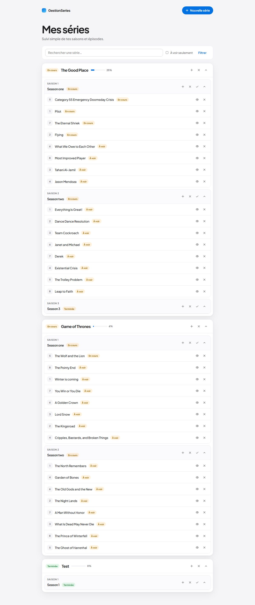
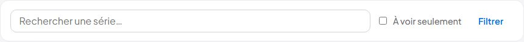
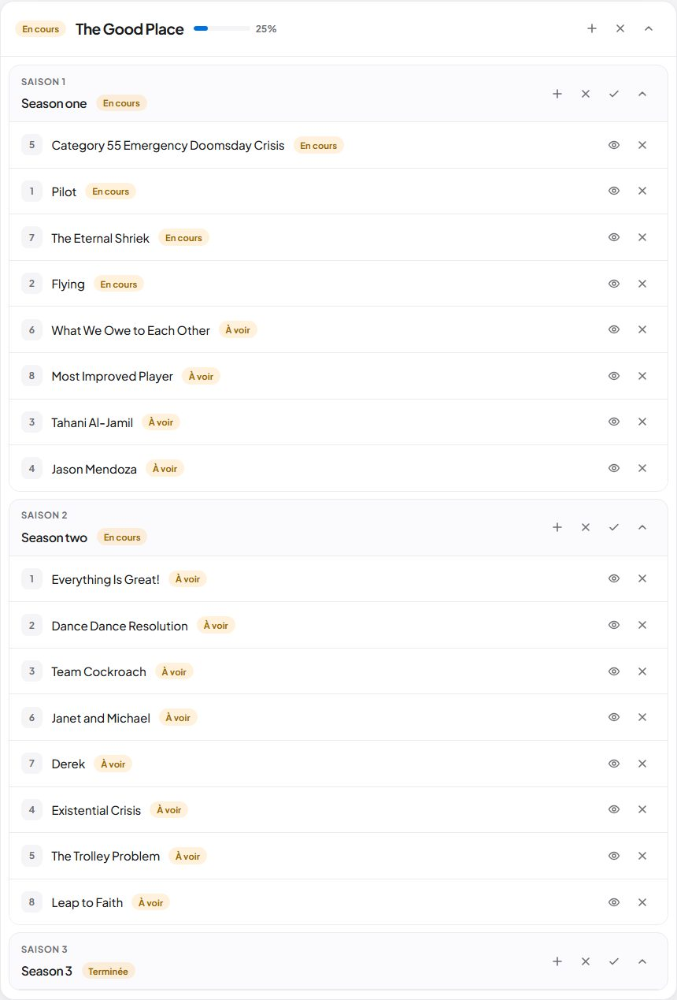

# GestionSeries — Documentation du projet

> Application locale pour suivre des **séries TV** (UI JSP + **API REST**).  
> UI : [http://localhost:8080/GestionSeries/](http://localhost:8080/GestionSeries/)  
> API : `http://localhost:8080/GestionSeries/api/…`  
> Sujets : TP JEE (DAO/JPA) + [`Rest API.pdf`](Rest%20API.pdf)  
> PDF illustré : [`docs/CompteRendu_GestionSeries.pdf`](docs/CompteRendu_GestionSeries.pdf)  
> Compte-rendu final (soucis + validation) : [`docs/CompteRendu_Final.md`](docs/CompteRendu_Final.md)

---

## Aperçu UI







---

## Glossaire

| Terme | Explication simple |
|-------|--------------------|
| **JEE / Jakarta EE** | Tech Java pour apps web serveur. Tomcat 10 → packages **`jakarta.*`**. |
| **Tomcat** | Serveur qui exécute le Java (port `8080`). |
| **Servlet** | Classe liée à une URL (`/liste`, `/etat`). |
| **`@WebServlet`** | Associe une URL à une servlet. |
| **JSP / JSTL** | Page HTML dynamique + balises (`<c:forEach>`, `<c:out>`…). |
| **GET / POST / PUT / DELETE** | Verbes HTTP : lire, créer, modifier, supprimer. |
| **DAO** | Couche d’accès aux données (interfaces + implémentations BDD). |
| **CRUD** | Create, Read, Update, Delete. |
| **Singleton / Factory** | Une instance + fabrique d’objets (`DaoFactory`). |
| **JPA / EclipseLink** | Mapping objets ↔ tables SQL. |
| **EntityManager** | Objet JPA qui lit/écrit (persist, merge, remove). |
| **EM par requête** | 1 EM par requête HTTP (thread-safe), via filtre. |
| **JPQL / Named Query** | Requêtes sur le modèle objet, nommées sur l’entité. |
| **LAZY / JOIN FETCH** | Chargement à la demande / forcé dans une requête. |
| **Maven / `pom.xml`** | Déclare et récupère les bibliothèques du projet. |
| **Flash message** | Message en session après redirect. |
| **API REST** | Interface HTTP **sans état** : chaque appel contient tout le nécessaire. |
| **Jersey** | Framework JAX-RS : route `/api/*` vers des classes `@Path`. |
| **JSON** | Format de données renvoyé par l’API. |
| **`@Path` / `@GET` / `@POST`** | Annotations Jersey pour URL + verbe HTTP. |
| **`@Produces` / `@Consumes`** | Type de sortie (JSON) / d’entrée (formulaire). |
| **`Response` / statuts HTTP** | 200 OK, 201 Created, 400 Bad Request, 403 Forbidden, 404 Not Found, 500… |
| **JWT** | *JSON Web Token* : jeton signé après login, prouve l’identité. |
| **Token** | Chaîne renvoyée par `/auth/login`, à renvoyer sur les actions protégées. |

---

## Architecture

```
Navigateur / Postman
        │
        ├─ UI  →  Servlets @WebServlet  →  ListeSeries.jsp
        │
        └─ API →  Jersey (/api/*)  →  services (@Path)
                    SeriesService, SaisonService, EpisodeService, AuthenticationService
        │
        ▼
 DaoFactory (Singleton + Factory)
        │
        ▼
 DAO BDD  →  EntityManager (1 / requête)  →  MySQL
```

L’UI JSP et l’API REST **coexistent** : même BDD, mêmes DAO.

---

## 1. TP JEE (conforme au premier PDF)

| Étapes | Réalisé |
|--------|---------|
| Tomcat, import, Run on Server | Oui |
| DAO CRUD + `DaoFactory` Singleton/Factory | Oui |
| Maven + MySQL + JPA (entités, named queries, transactions) | Oui |
| Suppressions série / saison / épisode | Oui |

**Adaptations :** `jakarta.*`, MySQL (pas PostgreSQL), EM **par requête**, LAZY + JOIN FETCH, flash session, redirects relatifs.

---

## 2. Bonus UI (hors premier PDF)

Recherche, filtre « à voir », progression %, marquer saison vue, toasts flash, scroll conservé, `ServletUtils`, `DataSeeder`.

---

## 3. API REST (`Rest API.pdf`)

### Phase A — Fondation Jersey

- Dépendances Maven Jersey **3.0.1** (+ JAR dans `WEB-INF/lib`)
- Servlet Jersey dans `web.xml` → `/api/*`
- Package scanné : `fr.pau.univ.series.services`

### Phase B — Services CRUD

| Méthode | URL | Body / params | Accès |
|---------|-----|---------------|-------|
| GET | `/api/serie/all` | — | public |
| GET | `/api/serie/{id}` | — | public |
| POST | `/api/serie/add` | `nom`, `token` | admin |
| DELETE | `/api/serie/delete/{id}` | query `token` | admin |
| POST | `/api/saison/add` | `serieId`, `nom`, `token` | admin |
| POST | `/api/episode/add` | `saisonId`, `titre`, `token` (+ `numero` optionnel) | admin |

### Phase C — Sécurité JWT

- Entité `User` + `UserRole` + `IUserDao` / `UserDaoBdd`
- `PasswordHelper` (hash PBKDF2, annexe PDF)
- `AuthenticationService` : login + création / vérif token
- Mutations protégées : token valide + rôle **`ROLE_ADMIN`**
- jjwt **0.11.5** (compatible Jakarta ; le PDF citait 0.9.1)

**Comptes seed** (créés au démarrage si table vide) :

| Login | Mot de passe | Rôle |
|-------|--------------|------|
| `admin` | `admin` | ROLE_ADMIN |
| `user` | `user` | ROLE_USER |

### Exemple — liste JSON

```java
@Path("/serie")
public class SeriesService {
  @GET
  @Path("/all")
  @Produces(MediaType.APPLICATION_JSON)
  public Response getSeries() {
    final List<Serie> ret = DaoFactory.getInstance().getSerieDao().readAllSeries();
    return Response.ok(new GenericEntity<List<Serie>>(ret) {}).build();
  }
}
```

### Exemple — login JWT

```java
@Path("/auth")
public class AuthenticationService {
  @POST
  @Path("/login")
  @Consumes(MediaType.APPLICATION_FORM_URLENCODED)
  public Response autenticateUser(MultivaluedMap<String, String> formParams) {
    // vérifie user/pwd → renvoie le token JWT
  }
}
```

### Tester avec Postman

Base : `http://localhost:8080/GestionSeries`

1. **GET** `/api/serie/all` → JSON des séries  
2. **POST** `/api/auth/login`  
   - Body → *x-www-form-urlencoded* : `user=admin`, `pwd=admin`  
   - Réponse = token (chaîne)  
3. **POST** `/api/serie/add`  
   - `nom=MaSerie`, `token=<coller le JWT>`  
4. **DELETE** `/api/serie/delete/3?token=<JWT>`

---

## 4. Lancer le projet

1. MySQL : schéma **`GestionSeries`**  
2. Vérifier `src/META-INF/persistence.xml` (user/mdp)  
3. Eclipse → **Run on Server** (Tomcat **10**)  
4. UI : [http://localhost:8080/GestionSeries/](http://localhost:8080/GestionSeries/)  
5. API : Postman sur `/api/…`

Tables créées/étendues au démarrage (`eclipselink.ddl-generation`).  
`DataSeeder` : séries d’exemple + utilisateurs API si absents.

---

## 5. Structure

```
GestionSeries/
├── README.md
├── pom.xml                          ← Maven (JPA, Jersey, jjwt…)
├── Rest API.pdf
├── docs/                            ← compte-rendu + captures UI
├── sql/
├── src/
│   ├── META-INF/persistence.xml
│   └── fr/pau/univ/series/
│       ├── dao/                     DaoFactory, Filter, Listener
│       ├── dao/interfaces/          ISerieDao, IUserDao…
│       ├── dao/impl/bdd/            *DaoBdd, DataSeeder, DaoBddHelper
│       ├── model/                   Serie, Saison, Episode, User
│       ├── servlets/                UI (Liste, Creer*, Supprimer*…)
│       ├── services/                REST (Series, Saison, Episode, Auth)
│       ├── util/                    PasswordHelper
│       └── exception/
└── WebContent/
    ├── WEB-INF/web.xml              ← mapping Jersey /api/*
    ├── WEB-INF/lib/                 ← JAR runtime
    ├── ListeSeries.jsp
    └── inc/
```

---

## 6. Points oral

1. **DAO + Factory** — découplage UI / API / stockage  
2. **JPA** — entités, JPQL, transactions, EM par requête  
3. **API REST + JWT** — Jersey sous `/api`, login public, écritures réservées admin  
4. **Écarts justifiés** — Jakarta/Tomcat 10, MySQL, jjwt 0.11 (au lieu de 0.9.1), LAZY+JOIN FETCH, flash session

---

## 7. Hors scope (volontairement)

Front React/Angular, tests automatisés H2, pagination lourde, cache L2, secrets hors code en production.
