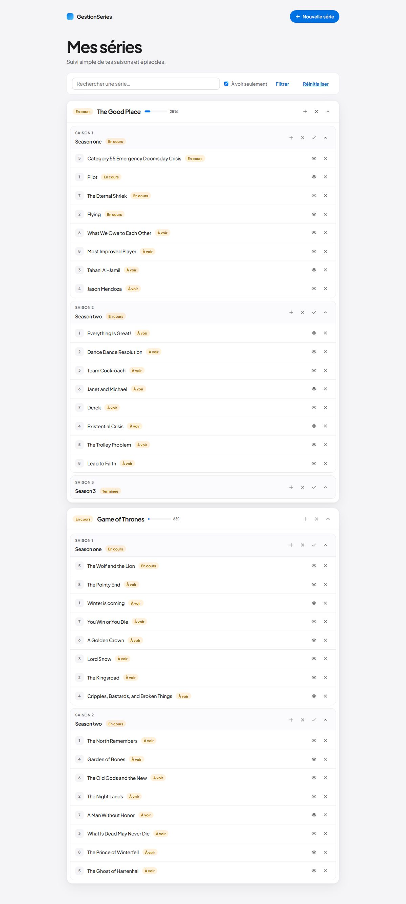

# GestionSeries — Compte-rendu du TP JEE

> Application locale pour suivre des **séries TV** (saisons, épisodes, état « vu »).  
> URL de démo : [http://localhost:8080/GestionSeries/](http://localhost:8080/GestionSeries/)  
> Sujet : `JEE_EnAttente de modification2.pdf` (AEN-Intech).  
> PDF illustré : [`docs/CompteRendu_GestionSeries.pdf`](docs/CompteRendu_GestionSeries.pdf)

---

## Aperçu de l’application

Page d’accueil réelle (`/liste`) :


Barre de recherche / filtre :


Détail d’une série (progression, saisons, épisodes, bouton œil = « vu ») :


Filtre « À voir seulement » activé :



---

## Glossaire — tous les termes importants

| Terme | Explication simple |
|-------|--------------------|
| **JEE / Jakarta EE** | Ensemble de technologies Java pour faire des **applications web côté serveur** (servlets, JSP, JPA…). Ancien nom : Java EE. Avec Tomcat 10, on utilise le préfixe de packages **`jakarta.*`** (plus `javax.*`). |
| **Tomcat** | **Serveur d’applications** qui exécute ton code Java et répond au navigateur (ici sur le port `8080`). |
| **Servlet** | Classe Java qui **réagit à une URL** (ex. `/liste`, `/etat`). Elle lit la requête HTTP, appelle la BDD via les DAO, puis envoie le résultat à une JSP ou fait un redirect. |
| **`@WebServlet`** | Annotation qui **associe une URL** à une servlet (équivalent de balises dans `web.xml`). |
| **JSP** | Page HTML **dynamique** côté serveur. Elle affiche les données préparées par la servlet (`${serie.nom}`, boucles `<c:forEach>`, etc.). |
| **JSTL** | Bibliothèque de balises pour les JSP (`<c:if>`, `<c:forEach>`, `<c:out>`…). Évite d’écrire du Java brut dans la page. |
| **HTTP GET / POST** | **GET** = lire / afficher (liste, filtres). **POST** = modifier (créer, supprimer, marquer vu). |
| **Redirect** | Le serveur dit au navigateur : « va sur cette autre URL ». Ici : après une action, retour vers `/liste`. |
| **Forward** | Le serveur **enchaîne en interne** vers une JSP **sans changer** l’URL vue par l’utilisateur. |
| **DAO** (*Data Access Object*) | Couche qui **parle à la base**. Les servlets ne font pas de SQL/JPA directement : elles passent par `ISerieDao`, etc. |
| **Interface** | Contrat (« quelles méthodes existent ») **sans** l’implémentation. Ex. `ISerieDao` → implémentée par `SerieDaoBdd`. |
| **CRUD** | Create / Read / Update / Delete — les 4 opérations de base sur les données. |
| **Singleton** | Design pattern : **une seule instance** d’une classe dans toute l’appli (`DaoFactory.getInstance()`). |
| **Factory** | Design pattern : une classe qui **fabrique / fournit** d’autres objets (`getSerieDao()`, etc.). |
| **JPA** (*Java Persistence API*) | Standard pour **mapper des objets Java ↔ tables SQL** via des annotations (`@Entity`, `@Id`…). |
| **EclipseLink** | **Implémentation** concrète de JPA utilisée ici (comme un « moteur » derrière l’API JPA). |
| **Entité** | Classe Java annotée `@Entity` qui correspond à une **table** (`Serie`, `Saison`, `Episode`). |
| **`persistence.xml`** | Fichier de config JPA : quelle base, quel driver, quelles entités, options EclipseLink. |
| **EntityManager (EM)** | Objet JPA qui **exécute** les lectures / écritures (persist, merge, remove, named queries). |
| **EntityManagerFactory (EMF)** | Usine qui **crée** des EntityManager. Coûteuse → créée **une fois** au démarrage. |
| **Thread-safe** | Code **sûr** si plusieurs requêtes (plusieurs onglets) tournent en parallèle. Un EM static partagé **ne l’est pas**. |
| **ThreadLocal** | Stockage d’une valeur **par thread** (ici : l’EM de la requête HTTP en cours). |
| **Filter servlet** | Code exécuté **autour** de chaque requête (`EntityManagerFilter` ouvre/ferme l’EM). |
| **JPQL** | Langage de requêtes JPA qui parle **objets** (`Serie s`) et non tables SQL brutes. |
| **Named Query** | Requête JPQL **nommée** et déclarée sur l’entité (`Serie.findAll`), puis appelée depuis le DAO. |
| **Transaction** | Groupe d’écritures BDD : soit **tout est validé** (`commit`), soit **tout est annulé** (`rollback`). |
| **persist / merge / remove** | JPA : **insérer**, **mettre à jour**, **supprimer** une entité. |
| **EAGER / LAZY** | Au chargement d’une série : **EAGER** charge aussi saisons/épisodes tout de suite ; **LAZY** les charge seulement si besoin. |
| **JOIN FETCH** | Dans une requête JPQL : force le chargement joint des relations (évite le problème « Lazy » sur la page liste). |
| **Cascade / orphanRemoval** | Si tu supprimes une série, JPA peut **supprimer aussi** ses saisons/épisodes liés. |
| **Maven / `pom.xml`** | Outil qui **télécharge les bibliothèques** (JSTL, MySQL, EclipseLink) et décrit le projet. |
| **JDBC Driver** | Pilote Java pour parler à MySQL (`com.mysql.cj.jdbc.Driver`). |
| **Flash message** | Message succès/erreur stocké en **session**, affiché **une fois** après un redirect (sinon il disparaît). |
| **`ContextPath`** | Préfixe d’URL de l’appli (`/GestionSeries`). On s’en sert pour des redirects portables. |

---

## Architecture (vue d’ensemble)

```
Navigateur  →  http://localhost:8080/GestionSeries/
      │
      ▼
 Servlets (@WebServlet)     +     ListeSeries.jsp (affichage)
      │
      ▼
 DaoFactory  (Singleton + Factory)
      │
      ▼
 SerieDaoBdd / SaisonDaoBdd / EpisodeDaoBdd
      │
      ▼
 DaoBddHelper  →  EntityManager (1 par requête HTTP)
      │
      ▼
 MySQL  (schéma GestionSeries)
```

**Pourquoi ces couches ?**  
Les servlets gèrent le web ; les DAO gèrent la BDD ; JPA traduit objets ↔ SQL. On peut changer le stockage sans réécrire toute l’UI.

---

## 1. Ce qui a été fait conformément au PDF

| Étapes du sujet | Pages | Dans le projet |
|-----------------|-------|----------------|
| Tomcat, import, Run on Server | 2–7 | Oui |
| Servlets / JSP / `@WebServlet` | 8–13 | Oui |
| Interfaces DAO + Javadoc + impl. BDD | 14–15 | `ISerieDao`, `SerieDaoBdd`… |
| `DataProvider` → `DaoFactory` | 16, 20–22 | Oui |
| `ListeSeries` via la factory | 23 | Oui (puis enrichi) |
| Maven + driver BDD | 24–27 | `pom.xml` |
| JPA, entités, relations | 32–52 | `Serie` / `Saison` / `Episode` |
| Named queries + transactions | 55–65 | Oui |
| Suppressions | fin du sujet | `SupprimerSerie`, `SupprimerSaison`, `SupprimerEpisode` |

### Capture de code — `DaoFactory` (Singleton + Factory)

Fichier réel : `src/fr/pau/univ/series/dao/DaoFactory.java`

```java
public class DaoFactory {

	private static DaoFactory instance;

	private ISerieDao serieDao = null;
	private ISaisonDao saisonDao = null;
	private IEpisodeDao episodeDao = null;

	public static final DaoFactory getInstance() throws DaoException {
		if (instance == null) {
			instance = new DaoFactory();
		}
		return instance;
	}

	private DaoFactory() throws DaoException {
	}

	public ISerieDao getSerieDao() throws DaoException {
		if (this.serieDao == null) {
			this.serieDao = new SerieDaoBdd();
		}
		return this.serieDao;
	}
	// idem getSaisonDao() / getEpisodeDao()
}
```

- `private static instance` + `getInstance()` + constructeur `private` → **Singleton**  
- `getSerieDao()` qui crée `SerieDaoBdd` → **Factory**

### Capture de code — Servlet liste

Fichier : `src/fr/pau/univ/series/servlets/ListeSeries.java`

```java
@WebServlet(urlPatterns = "/liste")
public class ListeSeries extends HttpServlet {

	@Override
	public void doGet(final HttpServletRequest request, final HttpServletResponse response)
			throws ServletException, IOException {
		ServletUtils.consumeFlash(request);
		final String q = request.getParameter("q");
		final boolean onlyAVoir = "1".equals(request.getParameter("aVoir"));
		request.setAttribute("q", q == null ? "" : q);
		request.setAttribute("aVoir", onlyAVoir);
		try {
			final List<Serie> series =
				DaoFactory.getInstance().getSerieDao().findSeries(q, onlyAVoir);
			request.setAttribute("series", series);
		} catch (final DaoException e) {
			request.setAttribute("erreur", e.getMessage());
		}
		this.getServletContext()
			.getRequestDispatcher("/ListeSeries.jsp")
			.forward(request, response);
	}
}
```

### Capture de code — Named Query + DAO

Sur l’entité (`Serie.java`) :

```java
@NamedQuery(name = "Serie.findAll",
	query = "SELECT DISTINCT s FROM Serie s "
	      + "LEFT JOIN FETCH s.saisons sa "
	      + "LEFT JOIN FETCH sa.episodes")
```

Dans le DAO (`SerieDaoBdd.java`) :

```java
result = this.bdd.getEm()
	.createNamedQuery("Serie.findAll", Serie.class)
	.getResultList();
```

---

## 2. Ce qui a dû être modifié par rapport au PDF

Le PDF date un peu (souvent `javax.*`, PostgreSQL, EM static). Environnement réel : **Tomcat 10 + Jakarta + MySQL WAMP**.

| Dans le PDF | Chez nous | Pourquoi |
|-------------|-----------|----------|
| `javax.servlet` / `javax.persistence` | `jakarta.*` | Tomcat 10 |
| Exemple PostgreSQL | MySQL `localhost:3306/GestionSeries` | WAMP |
| User Library EclipseLink 2.5 | Dépendance Maven EclipseLink 4 | Plus simple / Jakarta |
| Generate Tables manuel | `eclipselink.ddl-generation = create-or-extend-tables` | Tables au démarrage |
| **1 EM static** (p.41) | **EMF** + **1 EM / requête** (`EntityManagerFilter`) | Thread-safety |
| `FetchType.EAGER` | `LAZY` + `JOIN FETCH` | Moins de surcharge |
| URL absolue `http://host:port/...` | `request.getContextPath() + "/liste"` | Portable |
| Erreur en `request` puis redirect | **Flash en session** | Sinon le message disparaît |

### Capture de code — `persistence.xml` (réel)

```xml
<persistence-unit name="GestionSeries" transaction-type="RESOURCE_LOCAL">
  <provider>org.eclipse.persistence.jpa.PersistenceProvider</provider>
  <class>fr.pau.univ.series.model.Serie</class>
  <class>fr.pau.univ.series.model.Saison</class>
  <class>fr.pau.univ.series.model.Episode</class>
  <properties>
    <property name="jakarta.persistence.jdbc.driver" value="com.mysql.cj.jdbc.Driver"/>
    <property name="jakarta.persistence.jdbc.url"
      value="jdbc:mysql://localhost:3306/GestionSeries?serverTimezone=UTC&amp;useSSL=false&amp;allowPublicKeyRetrieval=true"/>
    <property name="jakarta.persistence.jdbc.user" value="root"/>
    <property name="jakarta.persistence.jdbc.password" value=""/>
    <property name="eclipselink.ddl-generation" value="create-or-extend-tables"/>
  </properties>
</persistence-unit>
```

### Capture de code — EntityManager par requête (écart volontaire)

Fichier : `EntityManagerFilter.java`

```java
@WebFilter("/*")
public class EntityManagerFilter implements Filter {

	@Override
	public void doFilter(final ServletRequest request, final ServletResponse response,
			final FilterChain chain) throws IOException, ServletException {
		final EntityManagerFactory emf = SeriesContextListener.getEntityManagerFactory();
		final EntityManager em = emf.createEntityManager();
		SeriesContextListener.bind(em);
		try {
			chain.doFilter(request, response);
		} finally {
			if (em.isOpen()) {
				em.close();
			}
			SeriesContextListener.clear();
		}
	}
}
```

**À retenir à l’oral :** le PDF met un EM en `static` ; ça marche en démo mono-utilisateur, mais **plusieurs onglets = risque**. On crée un EM **par requête**, on le ferme ensuite.

### Capture de code — relation LAZY (vs EAGER du PDF p.52)

```java
@OneToMany(fetch = FetchType.LAZY, cascade = CascadeType.ALL, orphanRemoval = true)
@JoinColumn(name = "fk_serie", referencedColumnName = "id")
public List<Saison> getSaisons() {
	return this.saisons;
}
```

---

## 3. Ce qui a été rajouté (hors sujet / bonus)

| Bonus | À quoi ça sert | Où |
|-------|----------------|-----|
| UI moderne | Lisibilité, look produit | `style.css`, `GestionSeries.js`, JSP |
| Flash succès / erreur | Feedback après create/delete/vu | `ServletUtils` + toasts |
| `ServletUtils` | Moins de code dupliqué dans les servlets | redirects, flash, parseId |
| `DataSeeder` | Séries d’exemple si BDD vide | démarrage Tomcat |
| Recherche `q` | Filtrer par nom | toolbar + `Serie.searchByNom` |
| Filtre `aVoir` | Ne garder que les séries non terminées | checkbox |
| Progression % | Voir l’avancement d’un coup d’œil | barre bleue sur chaque série |
| Marquer saison vue | Tout cocher d’un coup | `/marquerSaisonVue` |
| Ancre + scroll | Ne pas remonter en haut après « vu » | `#ep-…` + `sessionStorage` |
| Indexes SQL | Accélérer jointures / recherche | `sql/schema_jpa.sql` |

### Capture de code — flash + redirect relatif

```java
public static void setFlashSuccess(final HttpServletRequest request, final String message) {
	request.getSession(true).setAttribute(FLASH_SUCCESS, message);
}

public static void redirectListe(final HttpServletRequest request,
		final HttpServletResponse response) throws java.io.IOException {
	response.sendRedirect(request.getContextPath() + "/liste");
}
```

### Capture de code — bascule « vu » sur un épisode

Fichier : `ModifierEtat.java` (bouton œil dans l’UI)

```java
@WebServlet(urlPatterns = "/etat")
public class ModifierEtat extends HttpServlet {
	@Override
	protected void doPost(final HttpServletRequest request, final HttpServletResponse response)
			throws ServletException, IOException {
		String anchor = null;
		try {
			final Integer episodeId = ServletUtils.parseId(request.getParameter("episode"));
			anchor = "ep-" + episodeId;
			final Episode e = DaoFactory.getInstance().getEpisodeDao().readEpisode(episodeId);
			if (e != null) {
				e.setVu(!e.isVu());
				DaoFactory.getInstance().getEpisodeDao().updateEpisode(e, true);
				ServletUtils.setFlashSuccess(request,
					e.isVu() ? "Épisode marqué comme vu." : "Épisode marqué à voir.");
			}
		} catch (final Exception e) {
			ServletUtils.setFlashError(request, e.getMessage());
		}
		ServletUtils.redirectListe(request, response, anchor);
	}
}
```

### Capture de code — barre filtre dans la JSP

```jsp
<form class="toolbar" method="get" action="./liste">
  <input type="search" name="q" value="<c:out value='${q}' />"
         placeholder="Rechercher une série…" />
  <label>
    <input type="checkbox" name="aVoir" value="1"
           <c:if test="${aVoir}">checked</c:if> />
    À voir seulement
  </label>
  <button type="submit">Filtrer</button>
</form>
```

---

## 4. Comment lancer

1. MySQL (WAMP) : créer le schéma **`GestionSeries`**  
2. Vérifier user/mdp dans `src/META-INF/persistence.xml` (souvent `root` / vide)  
3. Eclipse → **Run on Server** (Tomcat **10**)  
4. Ouvrir [http://localhost:8080/GestionSeries/](http://localhost:8080/GestionSeries/)

Les tables sont créées/étendues au démarrage. Si la base est vide, `DataSeeder` ajoute des séries d’exemple.

---

## 5. Structure du projet

```
GestionSeries/
├── README.md
├── pom.xml
├── docs/
│   ├── CompteRendu_GestionSeries.pdf
│   └── captures/          ← captures localhost
├── sql/
├── src/
│   ├── META-INF/persistence.xml
│   └── fr/pau/univ/series/
│       ├── dao/                 DaoFactory, Filter, Listener
│       ├── dao/interfaces/      ISerieDao…
│       ├── dao/impl/bdd/        SerieDaoBdd, DaoBddHelper, DataSeeder
│       ├── model/               Serie, Saison, Episode
│       ├── servlets/            Liste, Creer*, Supprimer*, ModifierEtat…
│       └── exception/
└── WebContent/
    ├── ListeSeries.jsp
    ├── index.jsp
    └── inc/                     style.css, GestionSeries.js
```

---

## 6. Trois arguments solides pour l’oral

1. **DAO + Factory** — on découple l’UI du stockage.  
2. **JPA** — entités, named queries JPQL, transactions.  
3. **Écarts justifiés** — EM par requête (thread-safe), LAZY + JOIN FETCH, flash session (messages qui survivent au redirect).

---

## 7. Hors scope (volontairement)

Auth / CSRF, API REST, React/Angular, tests H2, pagination lourde : utiles plus tard, pas nécessaires pour ce TP local.
